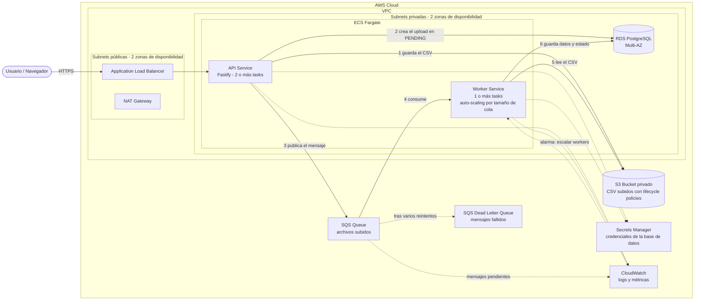

# Arquitectura en AWS (propuesta de despliegue)

Así se desplegaría el sistema en producción. Localmente se simplificó: PostgreSQL en Docker, archivos en disco y una cola simulada con archivos.

## Componentes

| Componente | Rol | Detalle |
|---|---|---|
| **VPC** | Red aislada | Subnets públicas (solo el balanceador y el NAT) y privadas (aplicación y base de datos), en 2 zonas de disponibilidad |
| **Application Load Balancer** | Entrada de tráfico | En subnets públicas; termina HTTPS y reparte entre las tasks de la API |
| **ECS Fargate - API Service** | Recibe uploads y responde consultas | 2 o más tasks en zonas distintas para alta disponibilidad |
| **ECS Fargate - Worker Service** | Procesa los CSV | 1 o más tasks; el número sube o baja según los mensajes pendientes en SQS |
| **RDS PostgreSQL** | Base de datos | Multi-AZ (réplica en espera en otra zona), en subnets privadas, sin acceso público |
| **S3** | Almacén de los CSV | Bucket privado con cifrado y lifecycle policies (por ejemplo, mover a almacenamiento frío o borrar a los 90 días) |
| **SQS + Dead Letter Queue** | Cola de trabajo | Si un mensaje falla varias veces, pasa a la DLQ para revisarlo sin perderlo |
| **Secrets Manager** | Credenciales | La contraseña de la base de datos se inyecta a las tasks; no vive en el código |
| **CloudWatch** | Observabilidad | Logs de API y worker, métricas y la alarma que escala a los workers |

## Notas de diseño

- **Las tasks están en subnets privadas.** Para llegar a S3 y SQS usan VPC endpoints (o el NAT Gateway), sin exponerse a internet.
- **API y worker son servicios separados** y escalan de forma independiente: la API según tráfico; el worker según el largo de la cola.
- **Permisos mínimos (IAM):** la API puede escribir en S3 y publicar en SQS; el worker puede leer de S3 y consumir de SQS.
- **El frontend** (Next.js) se podría servir desde otro servicio de ECS o desde un hosting estático detrás de CloudFront; queda fuera de este diagrama.
